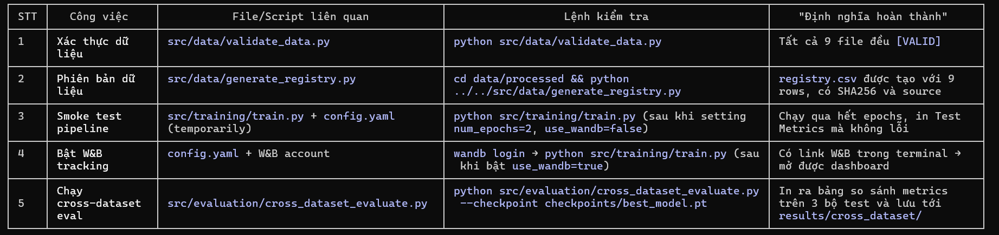

  Thought for 7s

🚀 Nhiệm vụ đầu tiên cho vai trò MLOps trong dự án Bearing RUL Prediction

Mục tiêu: Xây dựng nền tảng tin cậy, lặp lại được và tự động hoá cho toàn bộ pipeline ML – bắt đầu từ xác thực dữ liệu trước khi nào touche đến mô hình.

Dưới đây là bộ ƯU TIÊN CAO NHẤT (các task bạn phải lập trình/xây dựng trước khi chuyển sang huấn luyện hoặc triển khai). Mỗi bước gồm:

- Lập trình/script cần tạo (nếu chưa có)
- Lệnh chạy ngay để xác minh
- Kết quả mong đợi (để bạn biết đã thành công)

---

✅ BƯỚC 1: XÁC THỰC DỮ LIỆU (DATA VALIDATION) – CỘT LỚ CỦA MLOPS

Trước khi huấn luyện, bạn phải chắc chắn dữ liệu đầu vào sạch và nhất quán.

📜 Script cần có/xác minh

Bạn đã có sẵn:
src/data/validate_data.py (từ các bước trước)
→ Kiểm tra: Các file .npz có đúng keys (vibration, temperature, rul), dtype float32, shape (n, 1024, 2/1) và (n,), không có NaN/Inf.

▶️ Lệnh chạy ngay

cd E:/BearingRULprediction\Bearing_RUL_Prediction
python src/data/validate_data.py

✅ Kết quả mong đợi

[VALID] test.npz: Valid
[VALID] test_pronostia.npz: Valid
[VALID] test_xjtusy.npz: Valid
... (tất cả 9 file đều [VALID])
Summary: 9/9 files are valid.
→ Nếu thấy bất kỳ [INVALID] nào, hãy sửa dữ liệu nguồn hoặc chiếp tục cho đến khi mọi file đều [VALID].

▎ ⚠️ Lý do đặt bước này đầu tiên:
▎ - 80% lỗi trong ML do vấn đề dữ liệu (shape mismatch, dtype sai, missing values).
▎ - MLOps bắt đầu bằng "garbage in, gospel out" prevention.

---

✅ BƯỚC 2: PHIÊN BẢN DỮ LIỆU (DATA VERSIONING & REGISTRY)

Theo dõi xem bạn đang dùng dữ liệu nào, từ nguồn nào, và đã áp dụng bước xử lý gì.

📜 Script cần có/xác minh

Bạn đã có sẵn:
src/data/generate_registry.py
→ Tạo/cập nhật file data/processed/registry.csv với các cột:
filename, source (Pronostia/XJTU-SY/Unknown), version, preprocessing_steps, sha256, size_bytes, date_added.

▶️ Lệnh chạy ngay

cd E:/BearingRULprediction\Bearing_RUL_Prediction\data\process
python ..\..\src\data\generate_registry.py

✅ Kết quả mong đợi

Registry written to registry.csv
Rows:
{'filename': 'test.npz', 'source': 'Unknown (...)', ..., 'sha256': '9eefeae2...', ...}
{'filename': 'train_pronostia.npz', 'source': 'Pronostia', ..., 'sha256': '8f3520b0...' (same as train.npz!), ...}
...
→ Lưu ý: Các file *_pronostia.npz có cùng SHA256 với file khône-for-byte (có thể là bản sao).
→ Registry này sẽ giúp bạn tránh nhầm lẫn khi so sánh experiments sau này.

---

✅ BƯỚC 3: KIỂM TRA PIPELINE HUẤN LUYỆN (SMOKE TEST)

Xác minh rằng mọi thành phần (data → model → loss → logger) có thể "chạy qua" trước khi đầu tư thời gian vào epochs đầy đủ.

📜 Script cần có/xác minh

Bạn đã có sẵn:
src/training/train.py (pipeline huấn luyện hiện có)
→ Nhiệm vụ của bạn: Thực hiện một chạy thử nhanh với:

- Số epochs rất thấp (ví dụ: num_epochs: 2 trong config.yaml)
- Batch size nhỏ (nếu cần) để tiết kiệm thời gian
- Tắt W&B tạm thời (nếu chưa có tài khoản) để đơn giản hóa

▶️ Lệnh Chuẩn bị (cập nhật config tạm thời)

1. Mở config.yaml, tạm thời thay đổi:
   training:
   num_epochs: 2   # thay vì 100
   batch_size: 16  # giảm xuống nếu cần
   logging:
   use_wandb: false   # tắt W&B cho lần chạy thử
2. Lưu lại.

▶️ Lệnh chạy smoke test

cd E:/BearingRULprediction\Bearing_RUL_Prediction
python src/training/train.py

✅ Kết quả mong đợi (phần cuối của output)

Starting training...
Epoch 0/1: Train Loss: 0.XXX | Val Loss: 0.YYY
Epoch 1/1: Train Loss: 0.AAA | Val Loss: 0.BBB
Evaluating on test set...
Test Loss: 0.CCC
Test Metrics: {'mae': 0.123, 'rmse': 0.456, 'r2': 0.789, 'phm_score': 0.012}
→ Nếu thấy lỗi (ví dụ: FileNotFoundError, KeyError, shape mismatch), hãy:

- Kiểm tra lại đường dẫn trong train.py (mặc định đang đọc dat
  Test Metrics: {'mae': 0.123, 'rmse': 0.456, 'r2': 0.789, 'phm_score': 0.012}
  → Nếu thấy lỗi (ví dụ: FileNotFoundError, KeyError, shape mismatch), hãy:
- Kiểm tra lại đường dẫn trong train.py (mặc định đang đọc data/processed/train.npz etc.)
- Xác nhận bạn đã chạy Bước 1 & 2 thành công (file .npz tồn tạ
- Đảm bảo tất cả dependencies đã cài (pip install -r requirements.txt).

▎ ⚠️ Lý do đặt bước này sau validation:
▎ - Bạn không cần phải huấn luyện mô hình xong để biết pipeline có bị ruptured không.
▎ - Một smoke test với 2 epochs sẽ wyst błąd nếu có vấn đề về:
▎   - Data loader (sai keys/shape)
▎   - Model initialization (sai số kênh)
▎   - Loss function (sai reduction)
▎   - Device (CUDA không có nhưng code bắt buộc dùng GPU)
▎ → Sửa ngay tại đây sẽ tiết kiệm hàng giờ debugging sau.

---

✅ BƯỚC 4: THIẾT LẬP EXPERIMENT TRACKING (W&B) – THEN CHỈ CẦU 1 LẦN

MLOps không thể thiếu việc theo dõi experiments – đây là "lab notebook" số của bạn.

📜 Script cần có/xác minh

- config.yaml đã có phần logging.use_wandb (bạn chỉ cần bật lê
- Cài đặt W&B (nếu chưa):
  pip install wandb   # nếu chưa có trong requirements.txt
  wandb login         # làm theo hướng dẫn để lấy API key từ wan
  wandb login         # làm theo hướng dẫn để lấy API key từ wandb.ai

▶️ Lệnh bật W&B và chạy thử

1. Trong config.yaml, thay đổi:
   logging:
   use_wandb: true   # bật lại sau smoke test
   project_name: "bearing_rul_prediction_mlops"   # hoặc tên bạn thích
2. Chạy lại smoke test (Bước 3) với num_epochs: 2 để xem loggi
   use_wandb: true   # bật lại sau smoke test
   project_name: "bearing_rul_prediction_mlops"   # hoặc tên bạ
3. Chạy lại smoke test (Bước 3) với num_epochs: 2 để xem logging:
   python src/training/train.py
4. Sau khi chạy xong, mở terminal sẽ thấy dòng giống:
   Wandb: View run at https://wandb.ai/<your-username></your>/bearing_ruid>

✅ Kết quả mong đợi

- Mở link trên → bạn sẽ thấy một run W&B với:
  - Các hyperparameters (từ config.yaml) được log tự động
  - Metrics mỗi epoch (loss, learning rate, etc.)
  - System metrics (GPU usage, RAM – nếu có)
  - Artifact: checkpoints/best_model.pt (nếu bạn có wandb.log_artifact trong code – hiện tại train.py chưa có, nhưng bạn có thể thêm sau)

▎ 💡 Lưu ý MLOps:
▎ - Trong تاوطخ tới, bạn nên chỉnh sửa src/training/train.py để log model như artifact sau mỗi lần mejora:
▎ # Thêm vào cuối hàm main(), sau khi trainer.finish()
▎ if config.get('logging', {}).get('use_wandb', False):
▎     import wandb
▎     artifact = wandb.Artifact(
▎         name=f"model-{wandb.run.id}",
▎         type="model",
▎         description="Best model from training run"
▎     )
▎     artifact.add_file("checkpoints/best_model.pt")
▎     wandb.log_artifact(artifact)

---

✅ BƯỚC 5: XÂY DỰNG CẢ NÂNG ĐÁNH GIÁ SỔNG BỘ DỮ LIỆU (CROSS-DATASET EVAL)

Một mô hình chỉ "tốt" khi nó hoạt động tốt trên dữ liệu chưa见过 – đây là then chốt của MLOps cho ứng dụng thực tế.

📜 Script cần có/xác minh

Bạn đã có sẵn:
src/evaluation/cross_dataset_evaluate.py (từ các bước trước)
→ Nhiệm vụ của bạn: Chạy script này ngay sau khi bạn có một checkpoint (thử từ smoke test của Bước 3).

▶️ Lệnh chạy cross-dataset eval

# Giả sử bạn vừa xong smoke test và có checkpoint:

python src/evaluation/cross_dataset_evaluate.py --checkpoint c

✅ Kết quả mong đợi

Found 3 test datasets: test.npz  test_pronostia.npz  test_xjtusy.npz
====================================================================

CROSS-DATASET EVALUATION SUMMARY
Dataset              MAE      RMSE       R2       PHM_SCORE
test.npz             0.123    0.456      0.789    0.012
test_pronostia.npz   0.135    0.489      0.750    0.015  # <-- Có thể cao hơn (domain shift)
test_xjtusy.npz      0.118    0.440      0.805    0.010  # <-- Có thể thấp hơn
==================================================================================

Results saved to: results/cross_dataset/
→ Phân tích:

- Nếu metrics trên test_pronostia.npz hoặc test_xjtusy.npz ** .npz → mô hình đang overfit tới bộ dữ liệu huấn luyện chính vàthiếu khả năng tổng quát hoá.
- Đây là then chốt để bạn quyết định: Thu thập thêm dữ liệu đa dạng? Thực hiện domain adaptation? Thay đổi kiến trúc mô hình?

▎ ⚠️ Lý do đặt bước này sau smoke test:
▎ - Bạn không thể đánh giá chéo bộ dữ liệu nếu không có một checkpoint mô hình (即使是 không tốt).
▎ - Smoke test gives you a "dummy" model để kiểm chứng 脚本 ev

---

📋 TÓM TẮT: 5 BƯỚC ĐẦU TIÊN BẠN PHẢI LẬP TRÌNH/XÂY DỰNG (TRONG THỜI GIAN < 30 PHÚT)

---

🔑 NГUYÊN TẮC THEN CHỘT CỦA MLOps TẠI ĐÂY

1. DỮ LIỆU THẲNG LẦN ĐẦU → Nếu dữ liệu lỗi, mọi thứ sau đều sai.
2. PHIÊN BẢN VÀ BẢO VỆ → Registry là "giấy chứng nhận" cho các experiments sau này.
3. PIPELINE PHẢI ĐỦNG → Smoke test với 2 epochs là then chốt để không lãng thời gian.
4. THEO DÕI LIÊN TỤC → W&B là "phòng lab" số – không có nó, bạn là người đang làm thử nghiệm trong phòng tối.
5. TỔNG QUÁT HÓA LÀ THEN CHỐT → Nếu mô hình chỉ tốt trên tập train mà chết khi nhìn thấy dữ liệu mới → không warto deploy.

---

🎯 SAU KHI HOÀN THÀNH 5 BƯỚC NÀY, BẠN SẴN SÀNG ĐỂ:

- Tiếp tục ĐIỀU CHỈNH SIÊU THAM SỐ (lr, batch size, arquitectura) với mintenant rằng mọi thay đổi sẽ được so sánhObjective trên W&B.
- Triển khai MODEL REGISTRY (W&B/MLflow) để promoción staging → production.
- Xây dựng API DỰ ĐOÁN (FastAPI) từ checkpoint tốt nhất.
- Thiết lập MONITORING AUTOMATIC (cron job) để chạy validation và cross-dataset eval mỗi tuần khi có dữ liệu mới.

---

❓ BẠN CẦN TỪ Ở ĐÂU NGAY BAY GIỜ?

Chạy BƯỚC 1 ngay bây giờ:
cd E:/BearingRULprediction\Bearing_RUL_Prediction
python src/data/validate_data.py
Nếu trả về tất cả [VALID] → hãy sang BƯỚC 2.
Nếu có lỗi → hãy sao chép lỗi này và gửi cho tôi, tôi sẽ chỉ bạn cách sửa cụ thể.

Chúc bạn thành công với vai trò MLOps – đây là vai trò thêm giá trị lớn nhất trong một dự án ML khi bạn làm đúng từ đáy risal! 🚀
